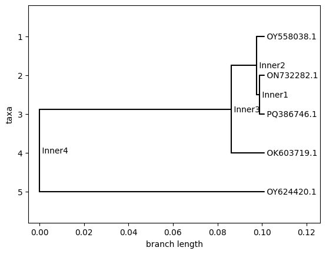

# SARS-CoV-2 Phylogenetic Tree

Traces how 5 SARS-CoV-2 variants (collected 2020–2024) are genetically 
related, using real genome data from NCBI.

## Methods Used
1. Downloaded 5 complete SARS-CoV-2 genomes in FASTA format from NCBI Virus
2. Aligned sequences with Clustal Omega
3. Built a phylogenetic tree using UPGMA (via Biopython)
4. Visualized the result

## Result

[PQ386746.1 (2024), ON732282.1 (2022), and OY558038.1 cluster closely together with short branch lengths, while OK603719.1 (2021) and especially OY624420.1 branch off much earlier, showing they’re more genetically distant from the rest.]

## Tools
Python, Biopython, Google Colab, Clustal Omega
